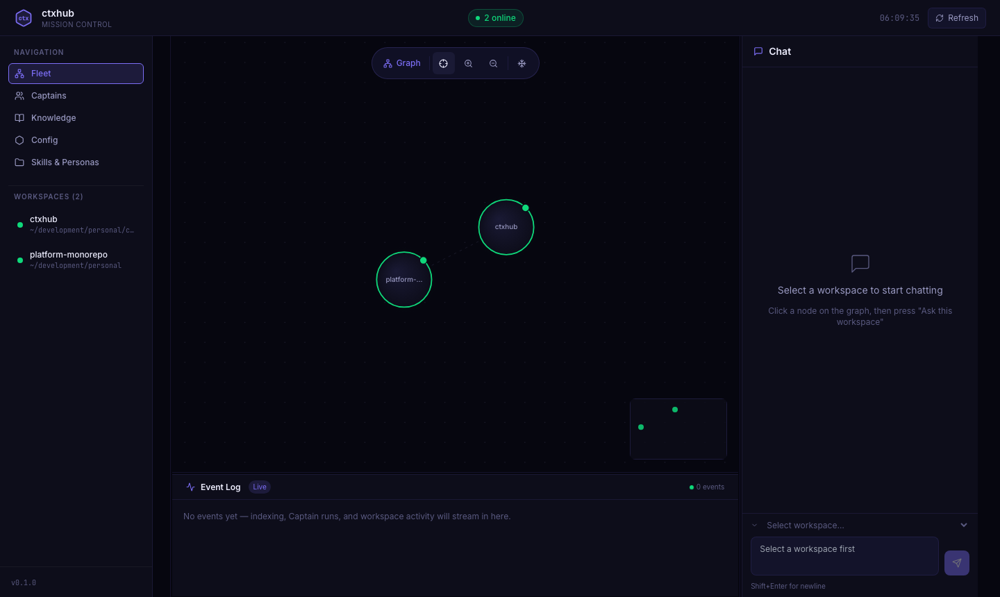
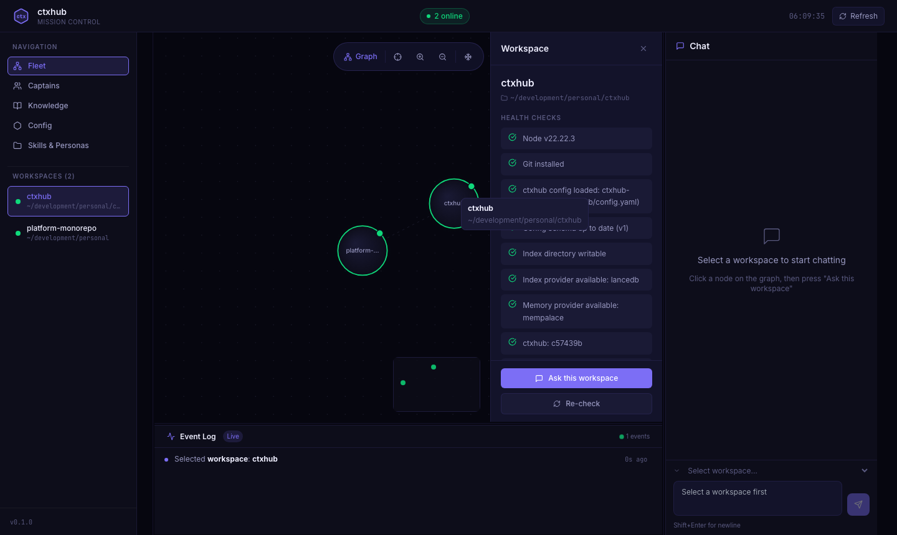
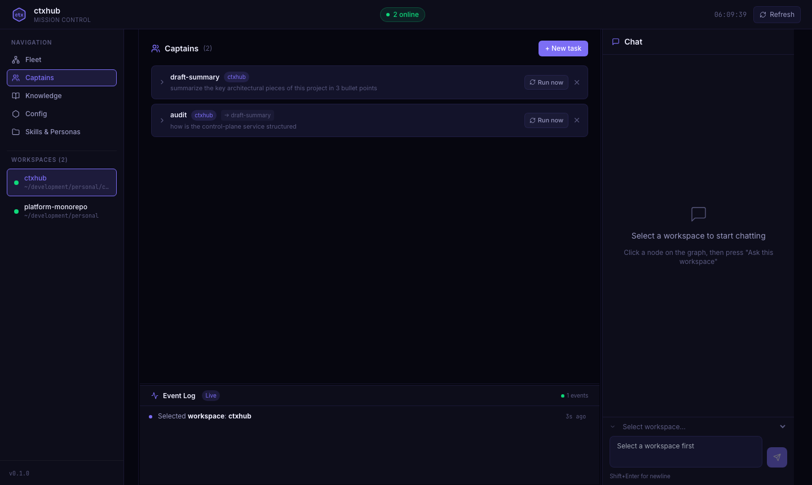
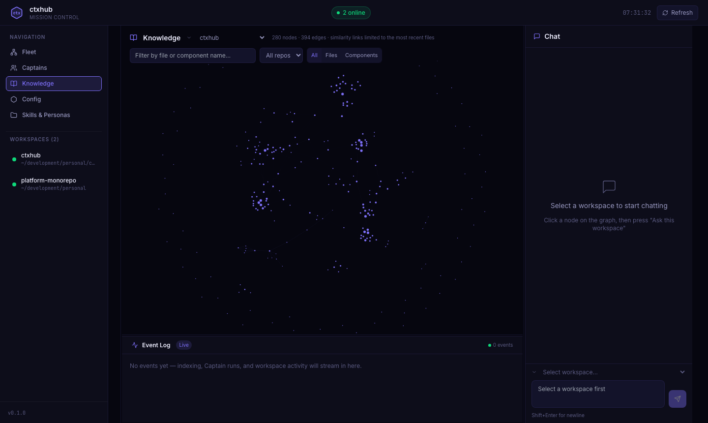
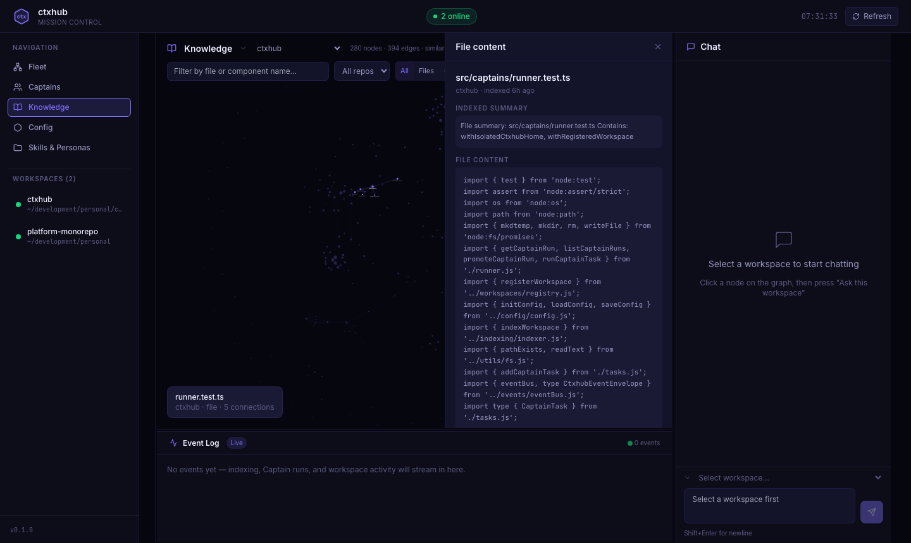
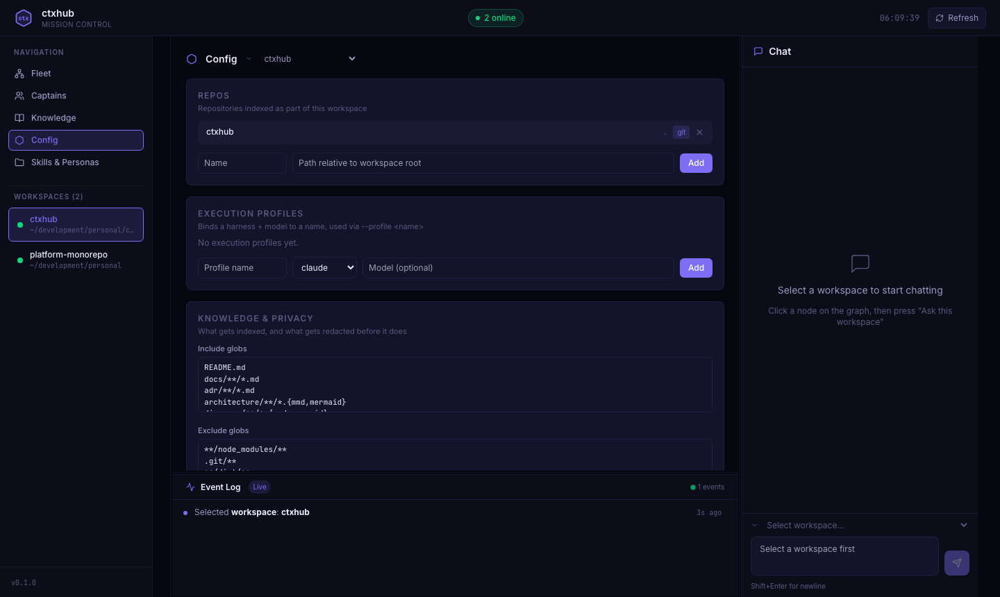
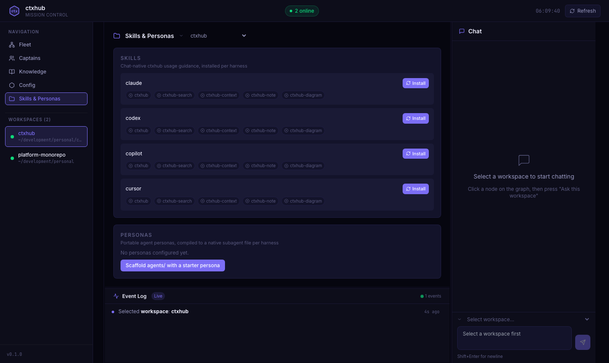
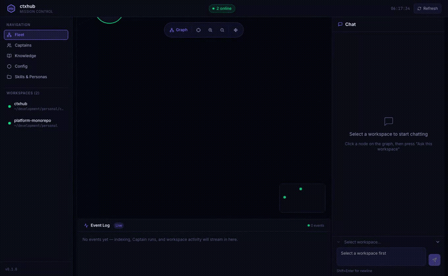

# ctxhub

**Make every AI agent understand your codebase.**

AI coding tools solved generation. They didn't solve context. They didn't solve coordination. They didn't solve memory. ctxhub does.

ctxhub is the open-source context layer for AI engineering. It gives your entire agent fleet — Claude, Codex, GitHub Copilot, Cursor, local models — a shared, searchable memory of your codebase, schedules agents to work on your behalf, and gives you a live dashboard to watch, control, and act on everything they find.

→ **[Quickstart](./docs/quickstart.md)** · **[Architecture](./docs/architecture.md)** · **[Philosophy](./docs/philosophy.md)** · **[Roadmap](./ROADMAP.md)**

---

## How it works

```
     Mission Control          ← watch, review, promote
           ▲
     ctxhub Runtime           ← index, memory, MCP, personas
           ▲
       AI Models              ← Claude, Codex, Cursor, Ollama
```

**The runtime** indexes your codebase and exposes it to every agent through MCP tools. Agents get shared, structured context instead of grepping repos themselves.

**Mission Control** is the live dashboard where you see what your agents are doing, review what they found, and promote findings into searchable institutional knowledge. Open it with `ctxhub dashboard`.

**The models are interchangeable.** ctxhub works with whatever you already use and doesn't care if that changes.

---

## Contents

- [Prerequisites](#prerequisites)
- [Install](#install)
- [Config](#config)
- [Guided mode](#guided-mode)
- [Commands](#commands)
  - [Setup](#setup)
  - [Indexing](#indexing)
  - [Search & context](#search--context)
  - [Review & analysis](#review--analysis)
  - [Memory](#memory)
  - [Agents & skills](#agents--skills)
  - [Notes & diagrams](#notes--diagrams)
  - [Control plane](#control-plane)
  - [Mission Control](#mission-control)
  - [Utilities](#utilities)
- [MCP server](#mcp-server)
- [LLM-backed features](#llm-backed-features)
- [Two kinds of agent memory](#two-kinds-of-agent-memory)
- [Personas](#personas)
- [Execution profiles](#execution-profiles)
- [Skills](#skills)
- [Hooks](#hooks)
- [Privacy](#privacy)
- [Extension points](#extension-points)

---

## Prerequisites

| Requirement | Notes |
|---|---|
| Node.js 22+ | Required |
| Git | Only needed for repo detection and `ctxhub sync` |
| MemPalace CLI | Optional. Install with `uv tool install mempalace`. Without it, durable memory is unavailable but everything else works. Or set `memory.provider: local-json` to skip the dependency entirely. |
| MCP-compatible client | Optional. Only needed if you use `ctxhub mcp`. |

---

## Install

Not yet published to npm. Install from a clone:

```bash
git clone <this-repo> && cd ctxhub
npm install && npm run build && npm link
```

Once published: `npm install -g ctxhub` (or `npx ctxhub@latest <command>`).

For local development without building: `npm run ctxhub -- --help`

---

## Config

Config is discovered by walking upward from the current directory, checking `ctxhub.yaml` then `.ctxhub/config.yaml`. The directory containing the config becomes the workspace root for all paths. Run any command from inside a child repo and ctxhub still uses the parent workspace — except `ctxhub init`, which always creates config exactly where you run it.

```yaml
version: 1
workspace:
  name: my-workspace

repositories:
  - name: app
    path: ./app
    include:
      - "README.md"
      - "docs/**/*.md"
      - "adr/**/*.md"
      - "docs/architecture/**/*.mmd"
    exclude:
      - "node_modules/**"
      - ".git/**"
      - "dist/**"

memory:
  provider: mempalace          # or local-json
  path: .ctxhub/memory/mempalace

index:
  provider: lancedb            # or local-json
  path: .ctxhub/index/lancedb
  table: ctxhub_chunks
  incremental: true
  chunkSize: 1800
  concurrency: 8               # parallel file prep; writes remain sequential

hooks:
  postPull: "npm --prefix ./app install"
  postIndex: "echo indexed $CTXHUB_WORKSPACE"

privacy:
  redactPatterns:
    - "(api[_-]?key|token|secret|password)\\s*[:=]\\s*[^\\s]+"
    - "AKIA[0-9A-Z]{16}"

llm:
  enabled: false               # opt-in; see LLM-backed features below
  timeoutMs: 120000
```

---

## Guided mode

Running `ctxhub` with no arguments opens an interactive menu. Type to filter the command list, arrow keys to move, enter to pick. A short wizard collects arguments before showing the exact command and asking for confirmation.

`ctxhub menu` does the same thing explicitly. The `ctxhub mcp` command is excluded from the menu since it's a long-running server.

---

## Commands

### Setup

| Command | What it does |
|---|---|
| `ctxhub init` | Create workspace config and `.ctxhub/` directories in the current directory. |
| `ctxhub onboard` | Guided wizard: init, repo discovery, hooks, memory provider, agents, skills, and initial index in one flow. Requires a real terminal; for non-interactive scripts use the individual commands. |
| `ctxhub doctor [--fix] [--dry-run]` | Check Node, Git, config schema, repo paths, index, memory provider, and whether installed skills/agent configs are stale. `--fix` applies safe repairs; `--dry-run` previews them. Use `--fix-skills` or `--fix-agent <name>` for the more invasive fixes (reinstalling skill files, refreshing MCP config). |
| `ctxhub ci init [--with-eval]` | Create a GitHub Actions workflow for build, `ctxhub validate docs`, and optionally `ctxhub eval`. |

After any ctxhub upgrade, the next command you run automatically checks for stale skills or agent configs and prints a one-line nudge — once per version, not on every command.

---

### Indexing

| Command | What it does |
|---|---|
| `ctxhub index [--notify]` | Index changed workspace files. Shows per-repo progress in a terminal; `--plain` for script output. Per-file prep (read, hash, chunk, optional LLM summary) runs at `index.concurrency` (default 8); writes are sequential. |
| `ctxhub sync [--no-pull] [--notify]` | Pull repos and re-index changed files. `--no-pull` skips the pull phase. |
| `ctxhub watch [--interval 30] [--detach] [--stop] [--status] [--notify]` | Watch for filesystem changes and re-index on change (via chokidar events, with `--interval` as a periodic fallback). `--detach` runs as a background process (PID file + logs in `.ctxhub/cache/`). |
| `ctxhub repo add <name> <path> [--suggest-globs]` | Add a repo, validate the path, detect Git. `--suggest-globs` asks the configured agent CLI for suggested `include`/`exclude` globs when `llm.enabled`. |
| `ctxhub repo list` | List configured repos. |
| `ctxhub repo discover [path] [--suggest-globs]` | Find Git repos below a folder. In a terminal, opens a review screen to choose which to add; `--plain` auto-adds new repos. |
| `ctxhub repo hook <name>` | Install a `post-commit` Git hook that re-indexes the workspace in the background after each commit. `-f/--force` overwrites an existing hook. |

---

### Search & context

| Command | What it does |
|---|---|
| `ctxhub search [query] [--rewrite-query]` | Search the index. Use `--type all\|docs\|code\|architecture\|notes` (or `--code`, `--docs` shortcuts). In a terminal, opens live search seeded with the query; `--plain` for one-shot output. `--rewrite-query` asks the agent CLI to rewrite the query before searching (shows both original and rewritten). |
| `ctxhub pack <query>` | Assemble an agent-ready context pack: search hits, architecture hits, freshness, status, repos, result-type counts, `rg` follow-up suggestions, and suggested reading order. `--out <file>` saves a portable replay artifact. |
| `ctxhub explain <query> [--notify]` | Citation-first explanation grounded in indexed context. With `llm.enabled`: real LLM-synthesized answer. Without: evidence scaffold. `--llm`/`--no-llm` override the config default. Never invents a citation. |
| `ctxhub ask <question> [--notify]` | Answer a direct question using the configured agent CLI. Unlike `explain`, this has no non-LLM fallback — it tells you to use `explain` or `pack` when disabled. |
| `ctxhub open <id>` | Print the full indexed chunk for a search result ID. |
| `ctxhub replay <file>` | Replay an exported context pack and compare recorded repo HEADs against current workspace. |

---

### Review & analysis

| Command | What it does |
|---|---|
| `ctxhub review <topic> --as <persona> [--base origin/main] [--json] [--notify]` | Review a topic using a named reviewer persona, grounded in the same diff/context-pack/architecture evidence as `pr-context` and `handoff`. Personas are data in `.ctxhub/cache/review-profiles.json`, auto-seeded with 5 built-ins on first run. |
| `ctxhub pr-context [--base origin/main] [--notify]` | Build a context pack for files changed on the current branch, with LLM-backed cross-repo contract-risk review when `llm.enabled`. |
| `ctxhub handoff <topic> [--from-pr] [--notify]` | Create a Markdown handoff bundle in `.ctxhub/cache/handoffs/`, with an LLM-synthesized summary section when `llm.enabled`. |
| `ctxhub graph [--json\|--drift]` | Summarize workspace components and relationships from indexed diagrams plus package metadata. `--drift` flags architecture references that are missing or unknown; `--fail-on-drift` makes those findings CI-failing. With `llm.enabled`, also suggests specific repairs. |
| `ctxhub validate docs [--json\|--strict-diagrams]` | Check Markdown local links and Mermaid diagram declarations. Strict mode adds syntax checks. |
| `ctxhub eval [--init\|--file\|--report\|--json\|--suggest-queries] [--notify]` | Run golden query checks against the index. Writes run history to `.ctxhub/cache/evals/`. `--suggest-queries` asks the agent CLI to propose additional cases. |
| `ctxhub eval --agent-report [--file\|--json] [--notify]` | Check whether an agent reaches for the tool ctxhub's skill docs recommend for realistic questions. Requires `llm.enabled`. |

**Built-in review personas:**

| Name | Kind | What it reviews |
|---|---|---|
| `bug-hunter` | generic | Likely runtime bugs in the diff |
| `security` | generic | Vulnerability risks |
| `performance` | generic | Performance and efficiency issues |
| `contract` | contract | Cross-repo contract risks (reuses `pr-context`) |
| `docs` | docs | Architecture drift (reuses `graph --drift`) |

Add custom personas by editing `.ctxhub/cache/review-profiles.json` — no code change required:

```json
{ "name": "naming", "kind": "generic", "focus": "Check for consistent naming conventions across the diff." }
```

---

### Memory

| Command | What it does |
|---|---|
| `ctxhub memory status` | Show MemPalace and LanceDB index status, including wing/room summaries. |
| `ctxhub memory add <content> [--wing] [--room]` | Store durable memory in MemPalace. Wing/room are auto-suggested from existing rooms when omitted. |
| `ctxhub memory search <query> [--wing] [--room] [--source-file]` | Search MemPalace, optionally scoped to a wing, room, or source file. |
| `ctxhub memory checkpoint [note] --agent <name> [--wing]` | Save a session-checkpoint diary entry, auto-assembled from the current git branch and recent commits. Lower-friction than `memory diary`. |
| `ctxhub memory diary <entry> --agent <name> [--wing]` | Write a durable diary entry to MemPalace for one agent. |
| `ctxhub memory timeline [entity]` | Show MemPalace knowledge-graph timeline events, optionally focused on one entity. |
| `ctxhub memory clear` | Clear the ctxhub index after confirmation. External MemPalace stores are left to MemPalace. |

---

### Agents & skills

| Command | What it does |
|---|---|
| `ctxhub agent <claude\|codex\|copilot>` | Write (or merge) the MCP config for that agent at the workspace root, then launch it. `--no-launch` to only write the config. Also wires up MemPalace's MCP server when configured and available. |
| `ctxhub skills install [agents...]` | Install chat-native skills for `claude`, `codex`, `copilot`, and/or `cursor`. Creates workspace-root canonical copies and links/copies them into each configured child repo. |

**Agent MCP config paths:**

| Agent | Config file | Scope |
|---|---|---|
| `claude` | `.mcp.json` | Project |
| `codex` | `.codex/config.toml` | Project (trust-gated — Codex only loads for trusted projects) |
| `copilot` | `~/.copilot/mcp-config.json` | User-level |

All merges are idempotent and preserve existing keys.

---

### Notes & diagrams

| Command | What it does |
|---|---|
| `ctxhub note add <repo> "<title>" [--agent] [--draft]` | Scaffold a dated note file in `<repo>/agent-notes/`. `--draft` asks the agent CLI to write a first draft when `llm.enabled`. |
| `ctxhub note promote <repo> <query> [--wing] [--room] [--hit] [--title] [--agent]` | Promote a MemPalace hit into a git-tracked team note. The explicit bridge from private memory to shared knowledge. |
| `ctxhub diagram add <repo> "<title>" [--agent] [--draft]` | Scaffold a dated Mermaid diagram in `<repo>/docs/architecture/`. `--draft` asks the agent CLI to write a first draft when `llm.enabled`. |

---

### Control plane

ctxhub includes an optional local control plane for managing multiple workspaces, running as a plain Node background process — no Docker required.

```
ctxhub service start     # starts on http://127.0.0.1:7342
ctxhub service stop
ctxhub service status
```

| Command | What it does |
|---|---|
| `ctxhub workspace register [path] [--name]` | Register a workspace in `~/.ctxhub/registry.json`. |
| `ctxhub workspace list` | List registered workspaces and their health. |
| `ctxhub workspace remove <name>` | Remove a workspace from the registry. |
| `ctxhub service start [--foreground]` | Start the control-plane service. Exposes `GET /health`, `GET /workspaces`, `GET /workspaces/:name/status`, `GET /events` (SSE), and Mission Control at `GET /`. |
| `ctxhub service stop` | Stop the running service. |
| `ctxhub service status` | Check whether the service is running. |
| `ctxhub dashboard [--port <port>]` | Start the service if it isn't already running (polling `/health` rather than a fixed sleep), then open Mission Control in your browser. |
| `ctxhub captain add <name> [--workspace] [--query] [--persona] [--profile] [--schedule-every-minutes] [--handoff-to]` | Define a Captain task that runs `ctxhub explain` unattended on a trigger, optionally handing its answer off as context to another task. |
| `ctxhub captain list` | List defined Captain tasks. |
| `ctxhub captain remove <name>` | Remove a Captain task. |
| `ctxhub captain run <name>` | Run a Captain task immediately. Output goes to a pending-approval queue, never directly to a repo. If the task has `handoffTo`, the target task runs next with the source answer folded in as context. |
| `ctxhub captain approvals` | List pending Captain runs awaiting promotion. |
| `ctxhub captain promote <runId> <repo>` | Promote a pending Captain run into a git-tracked note. |

### Mission Control

`ctxhub dashboard` opens a live web dashboard for every registered workspace — no separate build step, no CDN, served straight from the running service. Everything shown is real: an in-process event bus (`src/events/eventBus.ts`) pushes index progress, Captain runs, and skill/persona changes to the browser over SSE (`GET /events`) as they happen, animated as small bots traveling between nodes on the Fleet graph.

**Fleet** — every registered workspace as a node, colored by `ctxhub doctor` health, with live agent activity animated on top:



Click a node for its full doctor detail, or ask it a question directly from the chat panel — answers render real markdown (bold, lists, inline code) instead of raw text, and every citation that resolves to a real Knowledge graph node is clickable: it jumps to Knowledge, selects that file's node, and opens its real content preview. Citations that don't resolve (evidence outside the current graph) still show for transparency, just without the click affordance:



**Captains** — task list, run history, and handoff chains, with a form to define and run new tasks live. Promote any run straight into a git-tracked note without leaving the browser:



**Knowledge** — an Obsidian-style force-directed graph of the real indexed workspace: every indexed file gets a node (no display cap), plus components extracted from architecture diagrams. Filter by name to highlight matches, click a node to preview the real file content with matches highlighted inline — and to fetch that node's real similarity edges on demand, so clicking around organically expands the graph outward instead of being stuck with one fixed snapshot:




**Review** — run `ctxhub review --as <persona>` against a real base-branch diff without leaving the browser: pick a workspace, a built-in or team-defined reviewer persona, and a topic, and get back the same evidence-grounded findings/changed-files/suggested-context payload the CLI produces.

**Config** — repos, execution profiles, and knowledge/privacy settings for the selected workspace, editable live:



**Skills & Personas** — install skills and scaffold/sync personas per harness without leaving the browser:



A full walkthrough (indexing, a live Captain handoff, the Knowledge graph, Config, Skills & Personas, and a real chat exchange against the indexed content):

[docs/videos/dashboard-demo.mp4](./docs/videos/dashboard-demo.mp4)



---

### Utilities

| Command | What it does |
|---|---|
| `ctxhub report [-o path] [--open] [--memory-query] [--memory-wing] [--memory-room] [--timeline-entity]` | Generate a self-contained HTML workspace report: filterable list view, interactive knowledge graph, MemPalace timeline. No server, no CDN assets. `--open` launches in browser. |
| `ctxhub personas init` | Scaffold an `agents/` directory at the workspace root with starter persona and policy files. |
| `ctxhub personas sync` | Compile persona files into per-harness agent config (`.claude/agents/`, `.codex/agents/`, `.github/agents/`, `.cursor/agents/`). |

---

## MCP server

`ctxhub mcp` starts a [Model Context Protocol](https://modelcontextprotocol.io/) server over stdio. Uses the same upward config discovery as the CLI — launch from inside any child repo and it still resolves the parent workspace.

**Example config** (`.mcp.json` or `claude_desktop_config.json`):

```json
{
  "mcpServers": {
    "ctxhub": {
      "command": "ctxhub",
      "args": ["mcp"],
      "cwd": "/path/to/your/workspace"
    }
  }
}
```

**Read-only tools (always available):**

| Tool | Description |
|---|---|
| `search(query, limit?, type?)` | Ranked results with repo, path, type, heading, snippet. Type: `all`, `docs`, `code`, `architecture`, `notes`. |
| `context_pack(query, limit?)` | Same bundle as `ctxhub pack --json`. |
| `open_chunk(id)` | Full indexed chunk for a search result. TS/JS/JSX chunks are whole top-level functions/classes, not arbitrary slices. |
| `get_file_context(repo, path, line?, before?, after?, mode?)` | Context around a line. Defaults to the full enclosing function/method/class (`mode: "auto"`); pass `mode: "lines"` for a fixed line window. |
| `architecture_search(query, limit?)` | Search indexed Mermaid diagrams and Mermaid code blocks. |
| `architecture_map(query?)` | Components and relationships extracted from indexed diagrams. |
| `repo_list()` | Same output as `ctxhub repo list`. |
| `memory_status()` | MemPalace and index status, including wing/room summaries. |
| `memory_search(query, limit?, wing?, room?, source_file?)` | Search MemPalace durable memory. |
| `memory_timeline(entity?)` | MemPalace knowledge-graph timeline events. |

**Opt-in mutating tools:**

| Flag | Unlocks |
|---|---|
| `ctxhub mcp --allow-index` | `index_workspace(force?)`, `sync_workspace(noPull?)` |
| `ctxhub mcp --allow-memory-write` | `memory_add(content, wing, room, source_file?, added_by?)`, `diary_write(entry, agent_name, topic?, wing?)` |

The two flags are independent. `memory clear` is never exposed over MCP.

**Central MCP gateway** (control plane): `ctxhub mcp --central` exposes `list_workspaces` and `call_workspace_tool` to route requests across all registered workspaces without merging their indexes.

All MCP responses are auto-compacted: redundant content stripped, TOON vs compact JSON picked per payload, `maxTokens` trimming applied.

---

## LLM-backed features

Most of ctxhub is a read-only server with no LLM calls. A subset of features are opt-in:

```yaml
llm:
  enabled: false      # set true to enable
  agent: claude       # auto-detects claude/codex/copilot/cursor on PATH if unset
  timeoutMs: 120000
```

All LLM-backed features share three properties: **off by default**, **evidence-grounded** (built from context packs, diffs, and architecture graphs — never free-floating model knowledge), and **graceful fallback** (always falls back to the non-LLM behavior when disabled, unavailable, or timed out).

| Feature | Command | Without LLM |
|---|---|---|
| Synthesized answers | `explain`, `ask` | Evidence scaffold (`explain`); error with suggestion (`ask`) |
| Contract-risk review | `pr-context` | Raw diff context pack |
| Drift repair suggestions | `graph --drift` | Drift findings without repair suggestions |
| Handoff summaries | `handoff` | Structured bundle without summary section |
| Persona-framed reviews | `review --as <persona>` (generic kind) | Raw evidence bundle |
| Note/diagram drafts | `note add --draft`, `diagram add --draft` | Empty scaffold |
| Onboarding orientation | `onboard` (final step) | Skipped with value-prop notice |
| Query rewriting | `search --rewrite-query` | Original query used unchanged |
| File summaries at index time | `index` (large multi-chunk files) | Synthetic heading/symbol list |
| Repo glob suggestions | `repo add --suggest-globs` | No suggestions |
| Eval quality report | `eval --agent-report` | Not available |
| Golden query expansion | `eval --suggest-queries` | Not available |

Commands that accept `--llm`/`--no-llm` let you override the config default for a single call.

---

## Two kinds of agent memory

The ctxhub index is a read-only mirror of real repo content. Agent notes go to one of two separate, purpose-built paths:

| | MemPalace | `ctxhub note add` |
|---|---|---|
| **For** | Things worth remembering across your own sessions | Things worth a teammate seeing and reviewing |
| **Where** | `~/.mempalace/` — local, per-user, not git-tracked | `<repo>/agent-notes/<date>-<slug>.md` — git-tracked |
| **How to write** | MemPalace MCP tools (`mempalace_add_drawer`, etc.) or `ctxhub memory add` / `ctxhub memory diary` | `ctxhub note add <repo> "<title>"` scaffolds a stub; agent fills in the body |
| **Visibility** | Private to you | Shows up in PR diff; indexed once merged |

The crossing point is always explicit: `ctxhub note promote <repo> <query>` copies one MemPalace hit verbatim into a new team note, with a `promoted-from` field recording where it came from. Private memory stays private until you deliberately promote it.

---

## Personas

Personas define agent identity and decision-making as Markdown files in a git-tracked `agents/` directory at the workspace root (not under `.ctxhub/`, which is gitignored — personas are team assets meant to be version-controlled and reviewed):

```
agents/
  manifest.yaml
  personas/       → architect.md, implementer.md, reviewer.md…
  skills/         → review.md, debug.md, research.md…
  commands/       → review.md, implement.md, plan.md…
  rooms/          → architecture.md, security.md…
  policies/       → evidence.md, safety.md…
```

`ctxhub personas init` scaffolds the directory. `ctxhub personas sync` compiles personas into per-harness agent files:

| Harness | Output |
|---|---|
| Claude Code | `.claude/agents/<persona>.md` (YAML frontmatter) |
| Codex CLI | `.codex/agents/<persona>.toml` (TOML) |
| GitHub Copilot CLI | `.github/agents/<persona>.agent.md` (YAML frontmatter) |
| Cursor | `.cursor/agents/<persona>.md` (YAML frontmatter) |

`ctxhub doctor` detects drift between installed persona files and current source. `--fix --fix-personas` recompiles stale ones.

Use `--as <persona>` on `explain`, `ask`, `handoff`, and `review` to frame an LLM-backed answer through a persona's voice and policies.

---

## Execution profiles

Bind a persona to a specific harness + provider + model in config:

```yaml
executionProfiles:
  architect-primary:
    runtime: claude-code
    model: claude-opus-4
    tags: [premium, trusted, confidential]

  openrouter-economy:
    runtime: direct-api
    gateway:
      baseUrl: https://openrouter.ai/api/v1
      apiKeyEnv: OPENROUTER_API_KEY
    model: openrouter/auto
    tags: [experimental, non-confidential]

  vf3-bedrock:
    runtime: direct-api
    gateway:
      baseUrl: https://bedrock-runtime.eu-west-2.amazonaws.com
    model: eu.anthropic.claude-approved-profile
    tags: [vf3-approved, confidential, enterprise]
```

Use with `ctxhub explain --profile <name>`. The `direct-api` runtime calls any OpenAI-compatible endpoint (Ollama, LiteLLM, Portkey, enterprise proxies) using Node's built-in `fetch` — no extra dependency.

---

## Skills

`ctxhub skills install [agents...]` installs one focused skill per action:

| Skill | Invocation | What it does |
|---|---|---|
| `ctxhub` | Auto-invoked by agent judgment | Ambient nudge: "the answer might be in a different repo" |
| `ctxhub-search` | `/ctxhub-search <query>` | Explicit on-demand search with typed facets |
| `ctxhub-context` | Explicit | Context-pack gathering for broad cross-repo questions |
| `ctxhub-note` | Explicit | Capture findings as team-shared git-tracked notes |
| `ctxhub-diagram` | Explicit | Capture architecture as a reviewable Mermaid file |

Skills are installed per agent under their standard paths, with links back to the workspace-root canonical copies for child repos:

| Agent | Skill path |
|---|---|
| `claude` | `.claude/skills/<skill>/SKILL.md` |
| `codex` | `.agents/skills/<skill>/SKILL.md` |
| `copilot` | `.github/skills/<skill>/SKILL.md` |
| `cursor` | `.cursor/skills/<skill>/SKILL.md` |

---

## Hooks

**Config-level hooks** run after key lifecycle events:

```yaml
hooks:
  postPull: "npm --prefix ./app install"
  postIndex: "echo indexed $CTXHUB_WORKSPACE"
```

Both receive `CTXHUB_EVENT` and `CTXHUB_WORKSPACE` env vars. A failing hook prints a warning but does not fail the command.

**Git `post-commit` hook** — `ctxhub repo hook <name>` installs a `.git/hooks/post-commit` script that backgrounds a `ctxhub index` run after every local commit. Opt-in per repo; `--force` overwrites an existing hook.

---

## Privacy

The index excludes `.env` files by default and redacts common secret-like values before writing chunks. `privacy.redactPatterns` accepts JavaScript regex source strings; matches are replaced with `[REDACTED]`.

---

## Extension points

| Layer | Interface | Location |
|---|---|---|
| Index provider | `IndexProvider` | `src/indexing/IndexProvider.ts` |
| Memory adapter | `MemoryAdapter` | `src/memory/MemoryAdapter.ts` |
| Inference gateway | `InferenceGatewayAdapter` | `src/gateway/` |
| Task classifier | `TaskClassifier` | `src/captains/` |

Default implementations: LanceDB (index), MemPalace (memory), OpenAI-compatible (gateway). Local JSON fallbacks available for both index and memory.
