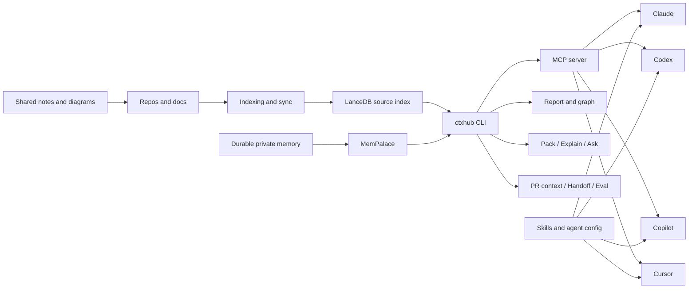
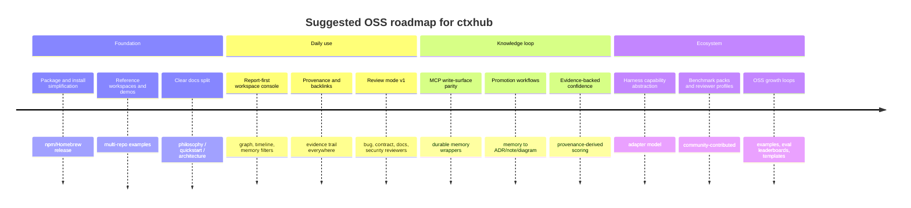

# ctxhub in the Developer AI Landscape

## Executive summary

ctxhub is best understood not as a monolithic “AI IDE”, but as a **harness-neutral context and workflow layer** for AI-first engineering. Its core value proposition is unusually clear: it indexes multi-repo source, docs, diagrams, and notes; exposes that context through a read-first CLI and MCP surface; keeps **durable memory separate from the source index**; and adds practical workflow primitives such as `pack`, `explain`, `ask`, `pr-context`, `handoff`, graph/reporting, note/diagram scaffolding, validation, and evaluation. In other words, it is trying to make whichever coding agent you already use materially better informed, rather than replacing that agent or forcing you into one editor or cloud runtime. fileciteturn0file1

That positioning gives ctxhub several real strengths relative to popular commercial tools. Compared with GitHub Copilot, Claude Code, OpenAI Codex, Cursor, and Cognition’s current Devin Desktop surface, ctxhub is more explicit about **multi-repo context assembly**, more opinionated about the separation between **private memory and reviewable team artefacts**, and more portable because it can be wired into multiple agent harnesses through MCP plus project-scoped skills and agent config. At the same time, the commercial tools are materially ahead on **turn-key autonomous execution**, **background agents**, **scheduled automations**, **integrated PR review**, **team administration**, and the polish of the end-to-end user experience. fileciteturn0file1turn0file2 citeturn4view0turn7view4turn28view1turn29view0turn19view1

For an AI-first engineering workflow, the current ctxhub feature set is already practically useful if the problem you actually have is: “my agent does not reliably understand my workspace, my sibling repos, my architecture docs, my prior decisions, or my handoffs.” In that setting, ctxhub’s search, context packs, architecture graphing, report/timeline output, memory wrappers, handoffs, and evidentiary `ask`/`explain` commands can meaningfully reduce context-switching and repeated explanation. The caveat is that ctxhub is still more of a **powerful substrate** than a finished daily console: the strongest next steps are not broad new capability categories, but better coherence around **review mode, provenance, write-path parity, memory promotion, and OSS packaging**. That diagnosis is also consistent with your own current backlog, which is now focused on report-first workspace UX, provenance/backlinks, graph polish, MCP write-surface parity, and memory workflow automation, rather than on basic feature coverage. fileciteturn0file1turn0file2turn0file0

My overall judgement is that ctxhub is already a credible OSS foundation for an AI-first workflow, especially for polyrepo or documentation-heavy teams. Its **highest-leverage differentiator** is not “another coding agent”, but “the open context fabric and memory/control plane that can make any coding agent more useful”. If that is the intended philosophy, the most important product work is to lean into it deliberately: make review collaborative, make provenance obvious, make memory promotion effortless, make harness integration first-class, and make adoption dead simple. fileciteturn0file1turn0file2turn0file0 citeturn20view1turn33view2turn33view3turn33view0

## Current ctxhub inventory

The current repository materials describe ctxhub as a reusable CLI for AI-assisted development workspaces that manages **multi-repo context**, indexes local documentation and source in **LanceDB**, and leaves durable agent memory to **MemPalace** by default. The README also makes two architectural choices especially explicit: the source index is deliberately **read-only**, and durable/personal memory is handled separately, either through MemPalace or via git-tracked notes and diagrams that become part of the workspace after review. fileciteturn0file1

In practical terms, the shipped surface is already broad. There is onboarding and guided mode; repo discovery and hooks; incremental indexing and sync; typed search; context-pack generation and replay; `explain` and `ask`; `pr-context`; `handoff`; self-contained HTML reporting with graph and timeline views; memory commands and search; doctoring and automated fixes; an MCP server; agent configuration for Claude, Codex, and Copilot; skill installation for Claude, Codex, Copilot, and Cursor; note and diagram scaffolding; architecture graphing and drift checks; doc validation; and golden-query evaluation, including an agent-report mode when LLM-backed features are enabled. LLM-backed paths are deliberately **opt-in**, disabled by default, and shell out to whichever configured agent CLI is already present rather than introducing a separate model provider dependency. fileciteturn0file1

That combination yields a coherent current identity: ctxhub is a **workspace intelligence layer** sitting between repository reality and the agent harness. The design is unusually explicit about where context should come from, how it should be consumed, and what should remain reviewable by humans. The README’s split between MemPalace for private/session memory and git-tracked notes/diagrams for team-shared knowledge is a particularly strong design choice for OSS, because it avoids polluting the searchable source layer with scratch notes while still giving agents somewhere durable to put learnings. fileciteturn0file1

The following diagram captures the current architecture at a high level, based on the documented command set and data flows. fileciteturn0file1

A more granular inventory is useful, because part of your brief was to separate what is already supported from what is merely proposed or unspecified.

| Capability area | Current status in ctxhub | Evidence |
|---|---|---|
| Multi-repo indexing and typed search | **Shipped** | `ctxhub init`, `repo add/discover`, `index`, `sync`, `search`, source-aware chunking, typed result classes. fileciteturn0file1 |
| Evidence assembly and replay | **Shipped** | `pack`, `replay`, `open`, freshness and repo-head comparison. fileciteturn0file1 |
| Grounded answer synthesis | **Shipped, opt-in for LLM mode** | `explain`, `ask`, search rewriting, index-time summaries. fileciteturn0file1 |
| PR / handoff context | **Shipped** | `pr-context`, `handoff`, LLM-backed summary and contract-risk review when enabled. fileciteturn0file1 |
| Architecture discovery and drift checks | **Shipped** | `diagram add`, `graph`, `validate docs`, drift detection and repair suggestions. fileciteturn0file1 |
| Memory separation and wrappers | **Shipped** | MemPalace integration, `memory add/diary/search/timeline`, separate git-tracked notes and diagrams. fileciteturn0file1 |
| Workspace UX / report / graph / timeline | **Shipped, but clearly still maturing** | `report` creates self-contained HTML with graph/memory/timeline surfaces; backlog explicitly prioritises turning it into a daily-use console. fileciteturn0file1turn0file0 |
| Harness adapters | **Partial** | `agent <name>` supports Claude, Codex, Copilot; `skills install` supports Claude, Codex, Copilot, Cursor. There is no documented general adapter SDK or capability abstraction yet. fileciteturn0file1 |
| CLI orchestration | **Shipped, bounded** | The CLI orchestrates indexing, context generation, reporting, evaluation, MCP, and note/diagram flows, but it does not position itself as a full general-purpose autonomous agent runtime. fileciteturn0file1turn0file2 |
| Review mode / Collaborative Review Mode | **Not documented as shipped** | The current docs include PR-context, eval loops, and sub-agent review ideas, but not a dedicated “Review Mode” or “Collaborative Review Mode”. fileciteturn0file1turn0file2 |
| Reviewer profiles | **Unspecified** | The available materials do not document reusable reviewer identities or review personas. fileciteturn0file1turn0file2 |
| Decision memory / ADR workflow | **Partial** | ADR content is indexable by default globs, and memory/notes can hold decisions, but there is no dedicated decision-promotion workflow yet. fileciteturn0file1turn0file0 |
| Expertise graph | **Unspecified** | The current graph covers repo/file/component/memory relationships, not people or expertise ownership. fileciteturn0file1turn0file0 |
| Campaigns | **Unspecified** | No documented campaign or long-running initiative management surface was found in the provided materials. fileciteturn0file1turn0file2 |
| Confidence scoring | **Not shipped** | In fact, your backlog explicitly frames provenance as groundwork for better ranking “without inventing confidence”, which implies no current confidence system. fileciteturn0file0 |
| Memory provenance/backlinks | **Backlog, high-priority** | Explicitly one of the current active backlog items. fileciteturn0file0 |
| MCP write-surface parity | **Backlog, high-priority** | Explicitly one of the current active backlog items. fileciteturn0file0 |
| Memory promotion workflows | **Backlog, high-priority** | Explicitly one of the current active backlog items. fileciteturn0file0 |

The current active backlog is also telling. The five “next wave” items are all about making the existing graph/memory/report surface feel like one coherent product: report-first workspace UX, provenance/backlinks, graph interaction polish, MCP write-surface parity for durable memory, and automation/promotion paths that move insights from ephemeral work into memory or team-shared artefacts. That is a sensible sign: it means ctxhub is now closer to the “integrate and harden” phase than the “invent core primitives” phase. fileciteturn0file0

The sub-agent brainstorm further sharpens the picture. It distinguishes two meanings of “sub-agents”: first, **cheap guidance** telling the host harness when to fan out or delegate; second, **ctxhub itself spawning bounded sub-agent runs** via the already configured harness CLI. The brainstorm and shipped README together suggest that ctxhub is already leaning toward the second path in a controlled way for features like `explain`, `ask`, `pr-context`, `handoff`, note/diagram draft generation, query rewriting, and agent-report evaluation, while still resisting the temptation to become yet another full proprietary agent platform. fileciteturn0file2turn0file1

## Competitor landscape

The market around ctxhub now breaks into four relevant clusters. The first is the **assistant-native coding surfaces**: GitHub Copilot, Claude Code, OpenAI Codex, Cursor, and today’s official Windsurf-branded surfaces, which now redirect to Devin Desktop and Devin Docs. These tools combine editing, agent loops, review, and increasingly background execution in an integrated product. GitHub Copilot now spans cloud agent, code review, Copilot CLI, custom agents, skills, hooks, and MCP; Claude Code spans terminal, VS Code, JetBrains, web, desktop, GitHub Actions, hooks, skills, auto memory, and custom subagents; OpenAI Codex combines a cloud software-engineering agent with isolated task sandboxes plus an open-source local CLI; Cursor positions itself as a coding agent with agents, cloud, CLI, automations, review, MCP/tool support, and codebase understanding; and the current Windsurf URLs officially resolve to Devin Desktop, whose docs emphasise a local agent harness, MCP, memories, context awareness, workflows, and fleets of local and cloud agents from a single surface. citeturn4view0turn35view5turn33view3turn33view4turn10view0turn12view0turn29view0turn30view0turn19view0turn19view1

The second cluster is the **context-first and code-intelligence tools**. Sourcegraph Cody still matters here because it uses Sourcegraph’s search and symbol/navigation stack to pull context from local and remote codebases, then layers chat, completions, prompts, and a CLI on top. In spirit, Cody is closer to ctxhub than Cursor or Claude Code are, because the centre of gravity is the quality of retrieved context rather than the agent loop itself. citeturn33view2

The third cluster is the **verification and security layer**: SonarQube, Snyk, and PR-review automations inside GitHub, Claude Code, Cursor Bugbot, and OpenHands. These tools are not direct substitutes for ctxhub’s context fabric, but they compete for one very important budget line: “AI that reviews, verifies, and keeps quality high.” SonarQube’s official position is automated verification of bugs, vulnerabilities, and maintainability issues in the IDE, on pull requests, and in CI/CD through quality gates. Snyk’s official position is scanning, prioritising, and fixing vulnerabilities across source, dependencies, containers, and cloud config. Cursor Bugbot markets itself as AI code review that catches “real bugs” with low false positives and runs automatically in the background on new PRs. GitHub Copilot code review supports both assignment-based and automatic reviews, can use memory and repository MCP for reviews, and explicitly warns that human review remains necessary. Claude Code provides GitHub Actions and a code-review skill path for automatic PR review. OpenHands explicitly lists automated code review among its use cases. citeturn33view0turn33view1turn30view0turn33view3turn26view5turn22view0

The fourth cluster is the **agent frameworks and harnesses**: LangGraph, AutoGen, CrewAI, OpenHands, and, in a looser sense, OpenClaw. LangGraph is a low-level orchestration runtime for long-running, stateful agents with persistence, interrupts, memory, subgraphs, and human-in-the-loop support. AutoGen is explicitly a framework for building single- and multi-agent applications, with an event-driven Core and extensions for MCP and Docker execution. CrewAI focuses on collaborative agents, flows, memory, knowledge, guardrails, observability, and enterprise triggers. OpenHands spans Agent Canvas, CLI, Cloud, hooks, MCP, plugins, repository customisation, and enterprise collaboration. OpenClaw, by contrast, is a general personal assistant you run on your own devices and across many messaging channels; it is relevant as an example of OSS agent ambition, but it is not developer-workflow-specific in the same way. citeturn20view1turn31view0turn31view1turn22view1turn24view0

A concise source register helps show the balance of this survey.

| Tool / family | Primary source used |
|---|---|
| GitHub Copilot | GitHub Docs on agentic workflows, code review, memory, custom agents, `/fleet`, MCP, and plans. citeturn6view0turn33view3turn33view4turn35view2turn35view1turn35view5turn7view5 |
| Claude Code | Claude Code Docs on overview, memory, skills, hooks, subagents, agent view, and GitHub Actions. citeturn4view0turn25view0turn27view2turn26view1turn27view1turn27view0turn26view5 |
| OpenAI Codex | OpenAI “Introducing Codex”, OpenAI Help on data analysis, and the official `openai/codex` GitHub repository. citeturn10view0turn28view4turn12view0 |
| Cursor | Official Cursor product page and Cursor Bugbot page. citeturn29view0turn30view0turn30view5turn30view6 |
| Windsurf / Devin | Official Windsurf URLs currently redirecting to Devin Desktop site and docs. citeturn19view0turn19view1 |
| Sourcegraph Cody | Sourcegraph Cody docs. citeturn33view2 |
| Snyk | Snyk user docs homepage. citeturn33view1 |
| SonarQube | SonarQube Server docs homepage. citeturn33view0 |
| OpenHands | OpenHands docs. citeturn22view0turn22view1 |
| LangGraph | LangChain LangGraph overview docs. citeturn20view1 |
| AutoGen | Microsoft AutoGen docs. citeturn31view0 |
| CrewAI | CrewAI docs. citeturn31view1 |
| OpenClaw | Official GitHub repository. citeturn24view0 |

## Comparative analysis

The comparative picture becomes clearer when you compare features directly rather than comparing brands.

| Feature | ctxhub support | Competitor examples | Maturity | Notes |
|---|---|---|---|---|
| Multi-repo indexing and local context search | **Yes** | Sourcegraph Cody uses advanced search across local and remote codebases; Cursor emphasises “complete codebase understanding”; Copilot includes repository indexing. fileciteturn0file1 citeturn33view2turn30view5turn34view0 | **Shipped** | This is one of ctxhub’s strongest and most distinctive foundations. |
| MCP-native context layer | **Yes** | Copilot supports repository MCP and CLI MCP; Claude Code promotes MCP as a standard connector layer; OpenHands and LangGraph also expose MCP-related usage. fileciteturn0file1 citeturn7view4turn35view5turn4view0turn22view1turn31view0 | **Shipped** | ctxhub’s value here is neutrality: it is not tied to one host product. |
| Harness adapters | **Partial** | Claude Code, Codex, Copilot, and Cursor all ship their own first-class harnesses. fileciteturn0file1 citeturn4view0turn12view0turn29view0turn6view0 | **Shipped but narrow** | ctxhub can configure Claude/Codex/Copilot and install skills for Cursor, but does not yet expose a unified adapter abstraction. |
| Skills / repository instructions | **Yes** | Claude Code skills plus `CLAUDE.md`; Codex uses `AGENTS.md`; Copilot has agent skills and custom agents; Cursor exposes rules/skills/MCP in product surfaces. fileciteturn0file1 citeturn25view0turn27view2turn28view0turn35view2turn30view3 | **Shipped** | Strong parity area; ctxhub is already competitive here. |
| Durable memory separated from source index | **Yes** | Claude Code auto memory and `CLAUDE.md`; Copilot Memory; LangGraph memory; CrewAI memory. fileciteturn0file1 citeturn25view0turn33view4turn20view1turn31view1 | **Shipped** | ctxhub’s split between private memory and git-tracked shared notes is unusually clear. |
| Team-shared reviewable notes and diagrams | **Yes** | Claude Code and Copilot can be guided by repo files, but ctxhub’s explicit `note add` / `diagram add` workflow is more opinionated. fileciteturn0file1 citeturn25view0turn28view0 | **Shipped** | This is a quiet differentiator for OSS workflows. |
| Grounded ask / explain over indexed evidence | **Yes** | Codex “Ask” mode for codebase questions; Cody chat with context; Claude/ Copilot/Cursor all answer with repo context. fileciteturn0file1 citeturn28view2turn33view2turn4view0turn29view0 | **Shipped** | ctxhub is strongest when the answer should be citation-backed and workspace-grounded. |
| Replayable context packs and handoff bundles | **Yes** | Claude Code background sessions, Codex task sandboxes, and Copilot sessions all support continuity, but ctxhub’s exported pack/replay artefacts are a more explicit portability mechanism. fileciteturn0file1 citeturn27view0turn28view3turn6view0 | **Shipped** | Particularly valuable for auditability and handoff across harnesses. |
| PR-context and cross-repo blast-radius review | **Partial** | Copilot code review, Cursor Bugbot, Claude GitHub Actions code review, SonarQube PR analysis, OpenHands automated code review. fileciteturn0file1turn0file2 citeturn33view3turn30view0turn26view5turn33view0turn22view0 | **Shipped but incomplete** | ctxhub has strong ingredients, but no first-class collaborative review mode yet. |
| Reviewer subagents and review personas | **Unspecified / partial concept only** | Claude Code custom subagents; Copilot `/fleet` subagents and custom agents; LangGraph, AutoGen, CrewAI all support specialised multi-agent roles. fileciteturn0file2 citeturn27view1turn35view1turn35view2turn20view1turn31view0turn31view1 | **Unspecified** | This is the clearest near-term gap if pair-programmer mode is important. |
| Architecture graph, diagrams, and drift | **Yes** | Most commercial tools can read docs, but explicit diagram drift and architecture search is less common; Claude/Copilot/Cursor rely more on generic repo context. fileciteturn0file1turn0file2 citeturn4view0turn29view0turn33view2 | **Shipped** | This is one of ctxhub’s most defensible unique strengths. |
| Human-facing report, graph, and timeline workspace | **Yes** | Devin Desktop/Windsurf and Cursor offer rich surfaces; LangSmith and Agent Canvas offer observability; ctxhub has a self-contained HTML report. fileciteturn0file1turn0file0 citeturn19view0turn19view1turn29view0turn20view1turn22view1 | **Shipped, but backlog focus** | Your own backlog correctly identifies this as the next coherence lever. |
| Evaluation and prompt/tool QA | **Yes** | LangSmith, LangGraph, and other frameworks emphasise evaluation; Copilot, Claude, and Cursor expose fewer repo-local golden-query loops out of the box. fileciteturn0file1turn0file2 citeturn20view1 | **Shipped** | ctxhub’s `eval --agent-report` is strategically important for OSS trust. |
| Autonomous background agents | **No** | Claude Code agent view/background sessions; Codex cloud sandbox tasks; Copilot cloud agent and automations; Cursor always-on automations; Devin fleets of local/cloud agents. fileciteturn0file1 citeturn27view0turn28view1turn35view3turn30view6turn19view1 | **Gap** | ctxhub delegates to host harnesses rather than owning this layer. That is both a limitation and a philosophy. |
| Scheduling and routines | **No direct core feature** | Claude Routines, Cursor Automations, Copilot Actions/automations. fileciteturn0file1 citeturn4view0turn30view6turn6view0 | **Gap** | Reasonable not to reimplement initially, but worth integrating better. |
| Enterprise administration / governance | **Minimal** | Copilot Business/Enterprise, OpenHands Cloud/Enterprise, Devin/Devin Desktop, Snyk, SonarQube all expose stronger governance or enterprise controls. fileciteturn0file1 citeturn7view5turn22view1turn19view1turn33view1turn33view0 | **Gap for commercial parity** | Less urgent for OSS, but relevant for adoption in larger teams. |
| Provenance and confidence scoring | **Partial / backlog** | Copilot Memory, SonarQube quality gates, Snyk risk/prioritisation, and commercial review products all invest in traceability or gating. fileciteturn0file0turn0file1 citeturn33view4turn33view0turn33view1 | **Backlog / gap** | Provenance matters more than pseudo-confidence; evidence-backed confidence can come later. |

The pattern across the table is consistent. ctxhub is already competitive in places where the problem is **context quality, evidence packaging, and portability**, and weak where the problem is **turn-key autonomous execution, polished review experience, and productised collaboration**. That is not a bug; it is the natural consequence of being a context layer rather than a full agent product. The strategic question is whether to double down on that layer and become the best OSS “developer context mesh”, or whether to drift toward becoming yet another all-in-one agent shell. The current docs and backlog strongly suggest the former is the better path. fileciteturn0file1turn0file0turn0file2

## Usefulness for AI-first engineering

For an AI-first workflow, ctxhub’s **most practically useful shipped features** are the ones that solve recurring failures of current coding agents. Agents often break down not because they cannot write code, but because they do not know where the relevant code lives, miss sibling repositories, fail to notice architecture docs or ADRs, forget prior decisions, or produce answers that are insufficiently grounded. ctxhub directly addresses those failure modes with multi-repo indexing, context packs, architecture-aware search, explicit memory surfaces, handoffs, replayable artefacts, and an MCP layer that can be reused across harnesses. In a polyrepo workspace, that is already enough to make Claude Code, Copilot, Codex, or Cursor materially better behaved. fileciteturn0file1 citeturn4view0turn33view3turn28view0turn29view0

Its strongest workflow fit is therefore **AI-augmented engineering inside an existing toolchain**, not “AI as the only tool”. If a developer already likes Claude Code, Copilot CLI, Codex CLI, or Cursor, ctxhub can act as the contextual substrate those tools query. That is a much more realistic OSS wedge than trying to beat the commercial vendors at integrated IDE polish or cloud execution. The README’s ability to write or merge agent configs for Claude, Codex, and Copilot, and to install skills for Claude, Codex, Copilot, and Cursor, is a direct expression of that philosophy. fileciteturn0file1

The present weaknesses are also clear. First, ctxhub still has an **integration-coherence problem**: it has many useful pieces, but the daily “workspace console” experience is not yet as strong as the underlying capabilities deserve. Your own backlog identifies this precisely. Second, review is not yet first-class enough. There is `pr-context`, there are note/diagram flows, there are sub-agent review ideas, and there is eval tooling, but there is no canonical “review mode” that would let a user ask for a sceptical reviewer, a performance reviewer, a security reviewer, or a contract reviewer in a repeatable way. Third, the write path is still split between ctxhub-native reads and raw MemPalace writes; your backlog diagnosis that this should converge is correct. Fourth, adoption friction is real: ctxhub is not yet published to npm, its install flow still requires clone/build/link, and the wider OSS community will not tolerate much setup complexity unless the payoff is immediate. fileciteturn0file1turn0file0

There are also strategic risks. A context-layer tool can easily become **too abstract** if it does not make at least one daily activity obviously better. For ctxhub, the most obvious daily activities to win are: “understand this multi-repo change”, “hand off what I learned”, “show me what the agent actually saw”, and “review this with the right sceptical lens”. If those become excellent, ctxhub has a durable OSS niche. If not, users may simply accept the commercial tools’ rough edges in exchange for convenience. The second risk is philosophical drift: every time ctxhub adds another bounded LLM path, it becomes easier to slide from “context and control plane” into “yet another agent product”. The README and brainstorm show healthy discipline here, but the pressure will increase as you add review and automation features. fileciteturn0file1turn0file2

The OSS adoption barriers are concrete rather than theoretical. Installation and packaging are still pre-public-release; many features require users already to have a preferred agent CLI; optional MemPalace adds another concept and dependency; and the sheer breadth of commands can make the project feel larger than its first-run payoff. On the other hand, those barriers are offset by two strong open-source advantages: the system is **local-first and inspectable**, and it does not require users to switch editor or provider. That combination is attractive to serious engineers who are comfortable composing tools but sceptical of vendor lock-in. fileciteturn0file1

## Recommendations

The highest-impact additions are the ones that reinforce ctxhub’s role as the open context and review fabric around whichever harness the user prefers, rather than trying to recreate Cursor or Claude Code wholesale.

| Recommended feature | Why it matters | Complexity | Expected user value |
|---|---|---|---|
| **Collaborative Review Mode** with reviewer subagents | This is the single clearest gap. Commercial tools already offer background PR review or automated review surfaces, and Claude/Copilot both support subagents or custom agents. ctxhub should turn its existing `pr-context`, eval, note, handoff, and architecture graph primitives into a named review workflow. Suggested built-ins: bug hunter, contract reviewer, security reviewer, performance reviewer, docs/diagram reviewer. fileciteturn0file1turn0file2 citeturn33view3turn30view0turn26view5turn35view1turn27view1 | **Medium–High** | **High** |
| **Reviewer profiles** | Make review mode reusable. A profile should encode prompt, tool permissions, evidence priorities, and output format. This is how you get from “cool demo” to “workflow primitive”. Copilot custom agents and Claude subagents both point in this direction. fileciteturn0file2 citeturn35view2turn27view1 | **Medium** | **High** |
| **Report-first workspace console with provenance/backlinks** | This is already your top backlog direction, and I think it is right. Users need one obvious place to inspect repos, memory, diagrams, graph relationships, and review findings together. Provenance and backlinks are prerequisites for trust. fileciteturn0file0turn0file1 | **Medium** | **High** |
| **Memory write-surface parity and promotion to ADRs/notes/diagrams** | Current users still need to reason too much about which surface to write to. Give them a structured flow from ephemeral work → durable memory → shared repo note/ADR/diagram. This would make ctxhub much stickier in daily use. fileciteturn0file0turn0file1 | **Medium** | **High** |
| **Cross-repo contract reviewer as an explicit PR gate** | This is one of the most compelling practical uses of ctxhub because it leans on the one thing many IDE agents still do badly: understanding downstream consumers across sibling repos. Cursor Bugbot, Copilot code review, SonarQube PR analysis, and OpenHands all validate demand for review automation; ctxhub can differentiate with cross-repo contract awareness. fileciteturn0file1turn0file2 citeturn30view0turn33view3turn33view0turn22view0 | **High** | **High** |
| **Harness capability abstraction** | Today ctxhub supports multiple harnesses, but unevenly. Introduce an internal capability model such as: “interactive chat”, “CLI batch”, “subagents”, “background sessions”, “MCP”, “skills”, “review hooks”. That lets ctxhub expose one portable UX and adapt underneath. It also makes community contributions easier when new harnesses appear. fileciteturn0file1turn0file2 citeturn4view0turn35view2turn12view0turn29view0 | **Medium–High** | **High** |
| **Evidence-backed confidence scoring** | You are right not to invent confidence. But once provenance/backlinks are in place, an evidence score based on number of corroborating repos, recency, doc/code agreement, and source type would be genuinely useful in review and handoff. That would be far better than model self-confidence. fileciteturn0file0turn0file1 | **Medium** | **Medium–High** |
| **OSS adoption kit** | Make install and first-run dramatically simpler: publish to npm/Homebrew, ship reference workspaces, add “why ctxhub?” examples, and package `eval` suites plus sample reviewer profiles. This is not glamorous, but it is probably the highest ROI community move after review mode. fileciteturn0file1 | **Low–Medium** | **High** |

A more narrative prioritisation is useful here.

The first priority should be **review** because it unifies a large fraction of the existing surface. Review mode can pull in `pr-context`, `ask`/`explain`, graph/architecture evidence, memory, note promotion, eval, and handoff. It also meets an obvious user need in a way the current command list does not yet package clearly. The second priority should be **workspace UX plus provenance**, because without an excellent human-facing surface the system will continue to feel like a bag of strong primitives rather than a daily console. The third priority should be **write-path parity and promotion workflows**, because knowledge capture is where most AI-first workflows still decay. The fourth priority should be **adapter and community infrastructure**, because OSS adoption will depend on reducing both setup cost and conceptual cost. fileciteturn0file0turn0file1turn0file2

## Roadmap and positioning

A short OSS roadmap should look less like a giant feature matrix and more like a sequence of milestones that compound trust and daily usefulness.

In practical terms, I would stage it this way.

**Near term**, make the project easier to adopt and easier to understand. That means publishable packaging, one exceptionally good quickstart, a small reference workspace, and a tighter split between README, ROADMAP, and PHILOSOPHY docs. Without this, the barrier to first use remains higher than it should be. fileciteturn0file1

**Next**, turn the report into the real human control plane and add provenance everywhere. This aligns exactly with your current active backlog and will improve both trust and discoverability. Users should be able to inspect the same state that the agent used, understand where facts came from, and promote useful insights into durable memory or shared docs without copy-paste churn. fileciteturn0file0turn0file1

**After that**, ship Review Mode and make it the flagship interaction. This is the most understandable story for new users: “bring any coding agent you like, and ctxhub gives you the review, context, memory, and cross-repo awareness those agents are usually missing.” That is easier to explain than a long list of commands, and more defensible than competing on raw code generation. The review workflow can then become the anchor for community-contributed reviewer profiles, templates, and eval cases. fileciteturn0file1turn0file2 citeturn33view3turn30view0turn26view5

For OSS positioning, the cleanest messaging is not “our AI agent is better than theirs”. It is something closer to the following.

**Vision.** “ctxhub is the open context and memory fabric for AI-first software engineering.” This says what it is without pretending to be everything. fileciteturn0file1turn0file2

**Philosophy.** “Bring your own harness; keep your repos canonical; keep evidence inspectable; keep memory honest; keep shared knowledge reviewable.” This crystallises the design choices already visible in the README: read-only source index, separate durable memory, git-tracked shared notes, MCP portability, and opt-in LLM synthesis. fileciteturn0file1

**Key differentiators.** ctxhub is harness-neutral rather than harness-bound; multi-repo and architecture-aware rather than single-repo chat-first; explicit about memory separation rather than vaguely persistent; and oriented toward replay, provenance, handoff, and review rather than purely toward code generation speed. These are meaningful differences from Copilot, Claude Code, Codex, Cursor, and the current Devin/Windsurf direction. fileciteturn0file1 citeturn33view3turn25view0turn28view1turn29view0turn19view1

**What not to say.** Avoid positioning ctxhub as “an open-source Cursor/Claude Code/Copilot alternative”. That invites direct comparison on the least favourable terms: integrated UX polish, model performance, and cloud execution. A better stance is: “ctxhub makes every agent you already use more trustworthy and more useful in real workspaces.” That claim is both more defensible and more aligned with the current implementation. fileciteturn0file1turn0file2