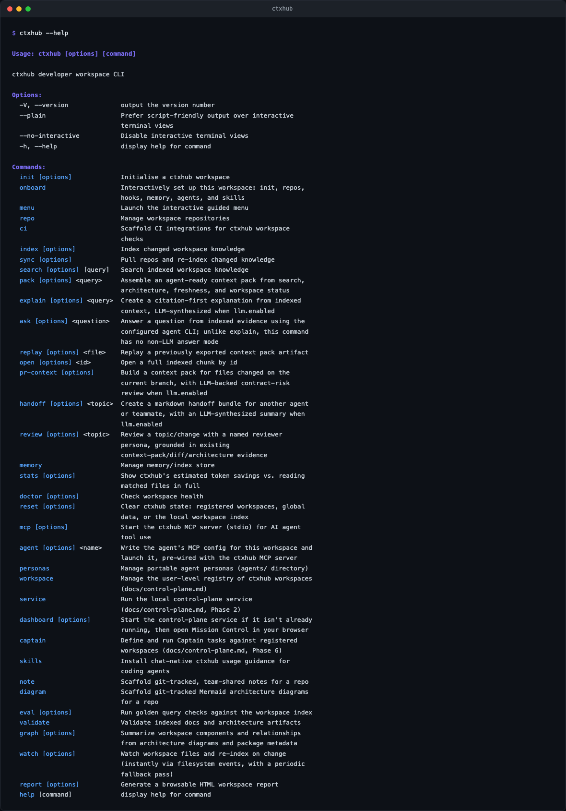
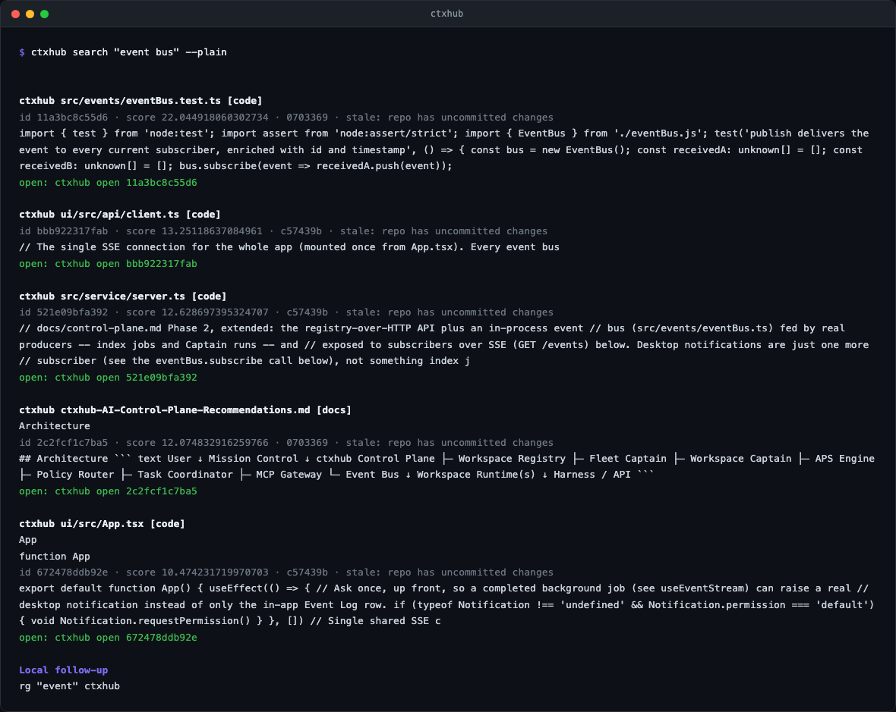

# Quickstart

ctxhub gives your AI agents a shared, searchable understanding of your codebase — and gives you Mission Control to watch what they find, review their work, and turn every engineering decision into searchable knowledge.

This guide gets you from zero to your first indexed workspace and first Captain result. ctxhub works with a single repo, a monorepo, or a parent directory holding several repos — pick the path that matches your situation.

**What you'll have at the end:**

```
your-repo/
  ctxhub.yaml          ← workspace config
  .ctxhub/
    index/             ← LanceDB search index
    cache/             ← evals, handoffs, health data
    memory/            ← MemPalace durable memory
  .mcp.json            ← agent MCP config (claude)
  .claude/skills/      ← installed skills
```



## Fastest: the reference workspace (no setup)

If you just want to see ctxhub working before setting up your own repo, use the small 3-repo
example bundled with this repo:

```bash
git clone <this-repo>
cd ctxhub
npm install && npm run build && npm link
cd examples/reference-workspace
ctxhub index
ctxhub search "authentication flow"
ctxhub graph
ctxhub report --open
```

See [examples/reference-workspace/README.md](../examples/reference-workspace/README.md) for more
things to try.



## Single repo (most common starting point)

If you have one git repo and want to add ctxhub to it:

```bash
cd /path/to/your-repo

# 1. Register with the control plane (needed for Mission Control UI)
ctxhub workspace register . --name my-project

# 2. Tell ctxhub which code to index
ctxhub repo add my-project .

# 3. Build the index
ctxhub index

# 4. Verify everything looks healthy
ctxhub doctor

# 5. Wire up your agent (Claude, Codex, etc.)
ctxhub agent claude
ctxhub skills install
```

That's it. The index is now searchable via MCP and the Mission Control dashboard. To keep the index
fresh automatically, add a post-commit hook:

```bash
ctxhub sync --hook
```

**The key step people miss:** `ctxhub repo add` must come before `ctxhub index`. Registering a
workspace (`workspace register`) tells the control plane the workspace exists; adding a repo
(`repo add`) tells the indexer what code to actually scan.

## Multi-repo or monorepo

If your workspace is a parent directory containing several git repos:

```bash
cd /path/to/workspace        # parent directory, not inside any single repo

ctxhub workspace register . --name my-workspace
ctxhub repo discover ./      # auto-detects git repos in subdirectories
ctxhub repo list             # verify what was found
ctxhub index
ctxhub doctor
ctxhub agent claude
ctxhub skills install
```

Or add repos manually if you want fine-grained control:

```bash
ctxhub repo add api      ./api
ctxhub repo add frontend ./frontend
ctxhub repo add infra    ./infra
ctxhub index
```

## Guided wizard (does all of the above interactively)

If you'd rather be walked through setup step by step:

```bash
cd /path/to/your-repo-or-workspace
ctxhub onboard
```

## Mission Control

To open the live dashboard — every registered workspace's health, a real-time event feed, Captain
runs, the Knowledge graph, and a chat panel to ask any workspace a question directly:

```bash
ctxhub dashboard
```

This starts the control-plane service if it isn't already running (polling `/health` rather than
guessing with a fixed sleep) and opens your browser to it. `ctxhub service start` + visiting
`http://localhost:7342` manually still works if you'd rather manage the service yourself.


See [README.md#mission-control](../README.md#mission-control) for every screen (Captains,
Knowledge, Config, Skills & Personas) and a full demo video.

## Day to day

**You mostly don't touch the CLI after setup.** That's the point of the MCP server and skills.

| Situation | What to do |
|---|---|
| Ask a question about your code | Just ask Claude/Codex — the `ctxhub` skill makes it check the index |
| Explicit search right now | `/ctxhub-search <query>` in Claude Code or Codex |
| Index feels stale | `ctxhub sync` (or auto via `post-commit` hook) |
| Added a new repo | `ctxhub repo add <name> <path>` then `ctxhub index` |
| Worth remembering personally | `ctxhub memory add "..."` → MemPalace |
| Worth the team seeing | `ctxhub note add <repo> "<title>"` → git-tracked note |
| Something feels off | `ctxhub doctor` |
| Upgraded ctxhub | Nothing — the next command auto-nudges if skills or config are stale |

See [Two kinds of agent memory](../README.md#two-kinds-of-agent-memory) for the full picture on
MemPalace vs. team notes.

## How config discovery works

ctxhub walks upward from the current directory looking for `ctxhub.yaml` or `.ctxhub/config.yaml`.
The directory containing that file becomes the workspace root. This means you can run
`ctxhub search` or `ctxhub index` from inside any subdirectory and it will find the right workspace
config. `ctxhub init` is the exception — it always creates a new config in the exact directory
where you run it.

## Worked example

Inside a Claude Code session, no CLI commands typed:

> **You**: How does the webhook receiver authenticate before invoking the notifications service?
>
> **Claude**: *(uses the `search` MCP tool)* — reads results from `webhooks-service` and
> `notifications-service`, answers with citations to both.

## Enterprise setup

This section covers the complete path for a production enterprise deployment — Entra ID SSO,
role-based access control, corporate groups, and self-hosted Docker/Helm deployment. It assumes
you are a technical admin and already have a working single-user ctxhub setup.

### Prerequisites

- Node 20+
- An Azure account with permission to register applications in Microsoft Entra ID (formerly Azure AD)
- Docker (for deployment) — see [Self-hosted deployment](#7-deploy)

### 1. Register the Entra ID app

In the [Azure portal](https://portal.azure.com):

1. Go to **Microsoft Entra ID → App registrations → New registration**
2. Set the application name (e.g. `ctxhub`)
3. Set the redirect URI to `http://localhost:7342/auth/callback` (or your production URL)
4. Under **API permissions**, add the following **delegated** Microsoft Graph permissions:
   - `openid`, `profile`, `email`, `offline_access`
   - `User.Read`
5. Under **Certificates & secrets**, create a new client secret and copy it immediately
6. Note your **Tenant ID** (Directory ID) and **Application (client) ID** from the Overview page

### 2. Configure ctxhub auth

```bash
ctxhub auth configure \
  --tenant-id <tenant-id> \
  --client-id <client-id> \
  --client-secret <secret>
ctxhub login
```

`ctxhub login` opens a browser window for the PKCE OAuth flow. On success it stores a JWT in
`~/.ctxhub/session.json`. You can also set these via environment variables
(`CTXHUB_TENANT_ID`, `CTXHUB_CLIENT_ID`, `CTXHUB_CLIENT_SECRET`, `CTXHUB_JWT_SECRET`) to avoid
storing secrets on disk.

### 3. Grant owner access

The first user to log in needs owner role to manage the instance. Check your login's `sub` claim
and grant the role before re-logging in:

```bash
ctxhub auth status        # copy the Sub: value shown
ctxhub auth role-map add-owner --sub <sub>
ctxhub login              # re-login so the new JWT includes the owner claim
```

To map an entire Entra group to a role:

```bash
ctxhub auth role-map add --group-id <entra-group-object-id> --role admin
```

### 4. Set up a corporate group (multi-entity orgs)

If your organisation has multiple legally separate entities that need to share knowledge (e.g.
Vodafone UK, Three UK, and Voxi as separate Entra tenants), create a corporate group:

```bash
ctxhub group create --name "My Corp Group"
# Note the group ID printed above
ctxhub group add-org --group-id <id> --name "Org A" --tenant-id <tenant-id-A>
ctxhub group add-org --group-id <id> --name "Org B" --tenant-id <tenant-id-B>

# Enable read sharing from Org A to Org B
ctxhub group sharing --group-id <id> --from-org <org-a-id> --to-org <org-b-id> --mode read
```

Cross-org search is automatically gated to `institutional` trust tier and above. Only knowledge
explicitly promoted by a captain or admin crosses org boundaries.

### 5. Index knowledge and verify

```bash
ctxhub index
ctxhub doctor --enterprise
```

`ctxhub doctor --enterprise` checks: auth configured, active session, role map populated, groups
store reachable, and indexed knowledge present.

### 6. Cloud sync (optional)

If you have a ctxhub Cloud endpoint, configure sync to push promoted chunks:

```bash
ctxhub cloud configure \
  --endpoint https://cloud.ctxhub.io \
  --api-key <key>
ctxhub cloud sync --dry-run   # preview how many chunks would be pushed
ctxhub cloud sync             # push institutional/canonical chunks to Cloud
```

### 7. Deploy

For a production self-hosted deployment (Docker Compose or Helm), see
[docs/deploy/SELF_HOSTED.md](./deploy/SELF_HOSTED.md). That guide covers:

- Docker Compose single-node setup
- Helm chart for Kubernetes
- Environment variable reference
- Data residency notes (all data remains within your own infrastructure)

---

## Next

- [architecture.md](./architecture.md) — how the pieces underneath work.
- [README.md](../README.md) — full command reference and config schema.
- [docs/deploy/SELF_HOSTED.md](./deploy/SELF_HOSTED.md) — production deployment guide.
